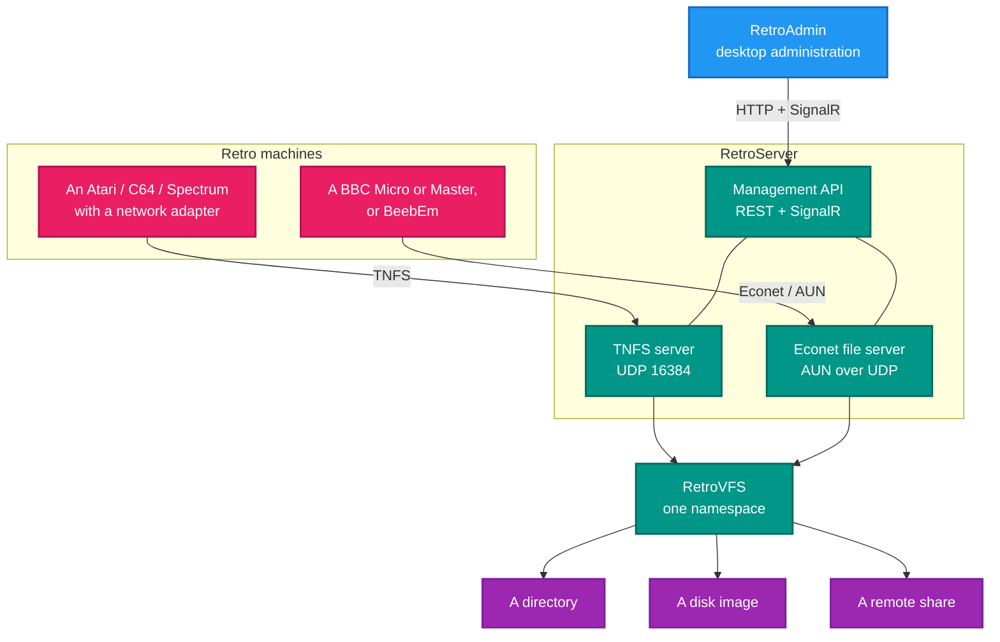
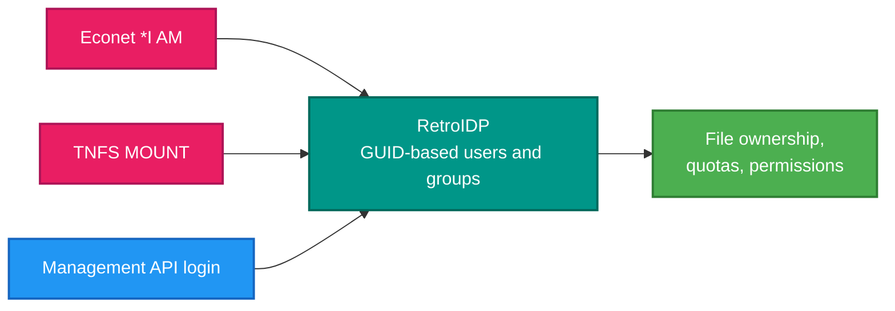

# RetroServer

**A file server for retro machines.** Two applications: a service that serves **TNFS** and **Econet/AUN** from any
storage RetroIO can mount, and a desktop app to administer it.

## Why this repo exists

An 8-bit machine with a network adapter — a FujiNet on an Atari, a Pi-based bridge on a BBC Micro — can reach files
over the network, but only in its own protocol. TNFS and Econet are what those machines speak, and neither is
served by anything you can install.

This serves both, from the same storage: a plain directory, a disk image, a remote share, or a mix of them at once.
The machine sees a filesystem and knows nothing about what is behind it.

The protocol and storage work lives in [RetroIO](https://github.com/RetroCoreLabs/RetroIO) and is consumed here as
NuGet packages. This repository is the **hosting** and the **administration**.

## The two applications

| Application | What it is | README |
|---|---|---|
| `RetroServer` | The server: TNFS + Econet, with a REST and SignalR management API | [README](src/RetroServer.Service/README.md) |
| `RetroAdmin` | Avalonia desktop app to watch and administer a running server | [README](src/RetroAdmin.Desktop/README.md) |

---

## Prerequisites

| # | Requirement | Needed for | How to check |
|---|---|---|---|
| P1 | .NET SDK as pinned in `global.json` | Everything | `dotnet --info` |
| P2 | PowerShell 7+ | `build.ps1` | `$PSVersionTable.PSVersion` |
| P3 | **RetroIO packed to `E:\Dev\RCL\localfeed`** | Restore | `dir E:\Dev\RCL\localfeed` |
| P4 | `.\build.ps1` run | Testing the published exes | `dir publish\win-x64\*.exe` |
| P5 | A free UDP 16384 (TNFS) and UDP port for AUN | Serving | `netstat -ano \| findstr 16384` |
| P6 | A free HTTP port for the management API | `RetroAdmin`, Swagger | Default URLs are printed at start-up |
| P7 | Something to serve | Anything useful | A directory, or a disk image |
| P8 | A Windows desktop session | `RetroAdmin` only | It is an Avalonia app |
| P9 | **A real 8-bit machine or an emulator** | An end-to-end test | FujiNet, a BBC Micro, or BeebEm |

```powershell
cd E:\Dev\RCL\RetroServer
.\build.ps1                          # build, test, publish both apps
publish\win-x64\RetroServer.exe      # run the server
```

Until the RetroIO packages are on nuget.org they come from the local feed, so **a fresh CI run is red until the
first publish**. That is expected.

---

## How it fits together



**One storage namespace, two protocols.** That is the point of the arrangement: a file added through TNFS is
visible over Econet, because both are views of the same mounted volumes.

---

## Identity is shared

Both protocols authenticate against **RetroIDP** — the same users, groups and passwords. Econet's `*I AM` resolves
to a `RetroUser` (case-insensitively); a TNFS mount authenticates the same way; the management API issues bearer
tokens for the same accounts.



The GUID is what makes that safe: rename a user, or reach them through a different protocol's spelling of the name,
and the ownership does not move. See
`RetroIO.Identity` (`RetroIO/src/RetroIO.Identity/README.md`).

---

## The honest gap

**Nothing in this family speaks AUN as a client of a full Econet session.** We serve Econet and can watch it, but
testing it end to end needs a BBC Micro, a Master, or BeebEm. That is recorded the same way in the manual test
documents, and a section that cannot be run must be marked **SKIPPED**, never passed.

TNFS has no such gap: `tnfs-stress` (`RetroIO/tools/RetroIO.Tools.TnfsStress/README.md`) loads it hard, and
`RetroCommander` is a TNFS client.

---

## Tests

| Project | Covers |
|---|---|
| `tests/RetroAdmin.Desktop.Tests` | The admin app |

The protocols and the storage are tested in RetroIO. A protocol bug found here should become a test **there** —
this repository hosts and administers; it does not implement.

Manual test procedures are in `E:\Dev\RCL\Migration\Manual tests - RetroServer.md`.

## Conventions

- Names follow the workspace naming standard; diagrams follow the workspace Mermaid palette. Both live one level
  up, **outside this repository**, so they are paths rather than links: `E:\Dev\RCL\NAMING.md` and
  `E:\Dev\RCL\MERMAID_COLOR_STANDARDS.md`.
- `python E:\Dev\RCL\eng\check-docs.py .` checks every link and diagram here.
- The org is **RetroCoreLabs**. `HackerCorpLabs` is retired.
