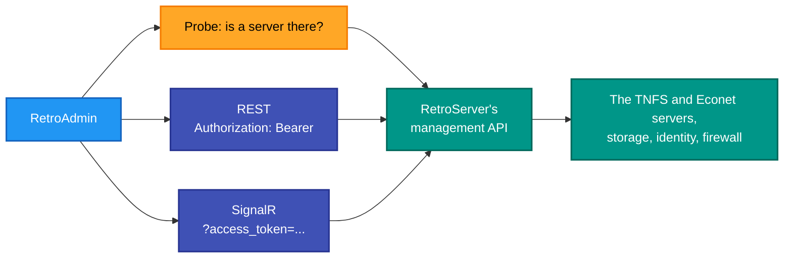
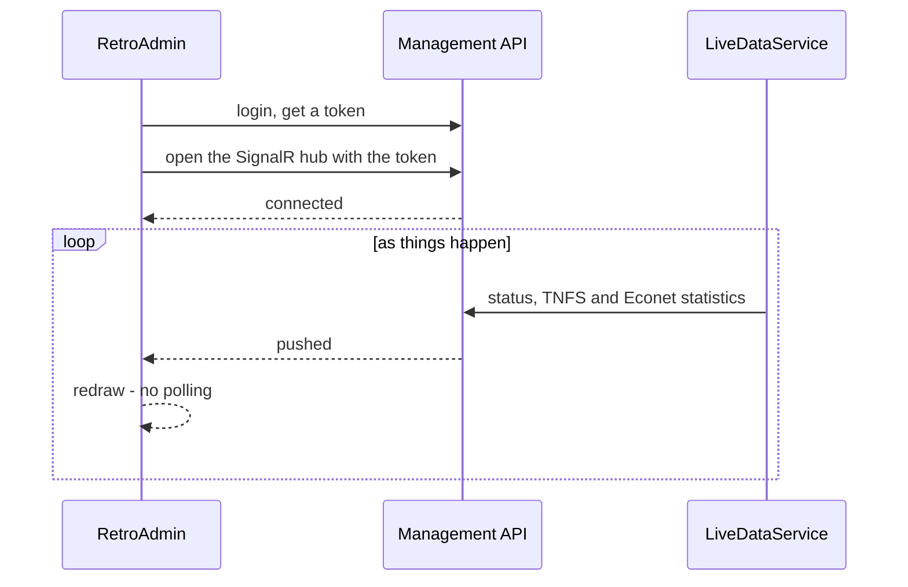

# RetroAdmin — the server administration app

> **Renamed.** This application was `RetroServeUI`. It is `RetroAdmin` now, in its own repository alongside the
> server it administers. The sections below still use some of the old wording; the behaviour is the same.

<!-- A still screenshot of RetroAdmin.Desktop doing its job. PNG, under 10 MB. Uncomment when
     the capture exists; keep the alt text, it is all a screen reader gets.

-->

## What it is

An Avalonia desktop application for **watching and administering a running RetroServer**. Start and stop the
server, see live TNFS and Econet activity, manage users and groups, mount volumes, edit the firewall, and read the
logs.

## Why you need it

A server is a process with no face. Everything it knows — who is connected, what they are reading, whether the
firewall is refusing somebody, how much traffic is flowing — is reachable over the management API, and reading that
by hand with `curl` is fine once and tiresome after that.

The part that genuinely needs a GUI is the **live** view. The API pushes status and statistics over SignalR rather
than making a client poll, so activity appears as it happens. A burst of traffic between two polls is invisible to a
polling dashboard and visible here.

It talks to the server **only over HTTP and SignalR** — the same API anything else would use. It does not reference
the protocol implementations, which is why it can administer a server running on another machine just as easily as
one running locally.

## What you can use it for

- **Starting and stopping** the server, and seeing its state.
- Watching TNFS connections, requests and transfer volume, with graphs over 12 hours, a week or a month.
- Watching **Econet** activity: recent commands and file transfers.
- Managing **users and groups** — the same RetroIDP accounts every protocol authenticates against.
- Mounting and browsing **volumes**.
- Editing **firewall** rules, including testing a rule before enabling it.
- Reading and filtering the server's **logs** remotely.

## Prerequisites

| # | Requirement | Why | How to check |
|---|---|---|---|
| P1 | .NET SDK as pinned in `global.json`, or the published exe | To build or run | `dotnet --info` |
| P2 | **A Windows desktop session** | It is an Avalonia GUI | Not usable over a plain SSH session |
| P3 | RetroIO packed to the local feed | Restore | `dir ..\localfeed` |
| P4 | **A reachable RetroServer management API** | Everything | The URL is printed when the server starts |
| P5 | Credentials | Anything past probing | A RetroIDP user |
| P6 | HTTPS if it is not local | The bearer token is a credential | |

> **Probe before you log in.** The client can tell "nothing is listening at this address" from "wrong password" —
> and reporting the first as the second has wasted time before. See
> `RetroIO.Management.Client` (`RetroIO/src/RetroIO.Management.Client/README.md`).

## How it reaches the server



**Two different ways the token travels**, and getting it wrong gives you working REST and a hub that silently never
connects: REST takes it in an `Authorization: Bearer` header, and the SignalR connection takes it as an
`access_token` query parameter — because a WebSocket handshake cannot carry a custom header.

## Live, not polled



> **First-launch caveat:** headless tests cannot catch compiled-binding errors or a missing `avares://` resource.
> Watch for those on the first window after a change — they appear at runtime and nowhere else.

## Related

- [`RetroServer`](../RetroServer.Service/README.md) — the server this administers.
- `RetroIO.Management.Client` (`RetroIO/src/RetroIO.Management.Client/README.md`) — the typed client it
  uses.
- `RetroIO.Management.Contracts` (`RetroIO/src/RetroIO.Management.Contracts/README.md`) — the DTOs, which
  depend on nothing, so this app does not ship the protocol stack.
- Tests: `tests/RetroAdmin.Desktop.Tests`.

---

## The detailed feature reference

RetroAdmin is an AvaloniaUI-based graphical user interface for managing the RetroFS server. It provides a
comprehensive dashboard for monitoring, configuring, and administering all aspects of the server.

## Features

### Server Control
- **Start/Stop Server**: Control the RetroFS server directly from the UI
- **Real-time Status**: Live server status indicator showing running/stopped state
- **Automatic Initialization**: Automatically creates default admin user and configuration

### Dashboard
- Server information overview
- Quick access to all management functions
- System status at a glance

### TNFS Monitor
- **Active Connection Tracking**: Real-time display of active TNFS connections
- **Request Statistics**: Monitor total requests and data transfer
- **Performance Graphs**: Visual charts showing:
  - Requests over time (12h, 1w, 1m timeframes)
  - Data transfer in MB/GB
  - Files sent and received
- **Time Range Selection**: View statistics for last 12 hours, 1 week, or 1 month

### Volume Management
- List mounted volumes
- View volume details (type, path, mount status)
- Manage disk image mounts

### User & Group Management (RetroIDP)
- **User Administration**:
  - Create new users with username/password
  - View existing users and their group memberships
  - Manage user permissions
- **Group Management**:
  - Create and manage user groups
  - View group members
  - Assign group permissions

### Log Viewer
- **Real-time Logs**: Live streaming of server logs
- **Filtering**: Filter logs by level (Info, Warning, Error)
- **Search**: Search through log messages
- **Clear History**: Clear old log entries (keeps last 1000)

### Firewall Configuration
- Enable/disable firewall
- View and manage firewall rules
- IP allow/block lists
- Network CIDR rules

### Server Settings
- **TNFS Configuration**:
  - Root directory path
  - UDP/TCP enable/disable toggles
  - Port configuration (UDP and TCP)
- **Backend Selection**: Local or Azure Blob Storage

## Color Scheme

The UI uses the official RetroFS color scheme based on the project logo:

- **Primary Green** (#00FF00): Accent color, success states, active elements
- **Orange** (#FFA500): Secondary accent, warnings, highlights
- **Dark Blue** (#1A1F2E): Main background
- **Navy Blue** (#0F1419): Alternate background, sidebar
- **White/Light Gray**: Text and borders

## Architecture

### Technology Stack
- **Framework**: .NET 9.0
- **UI Framework**: AvaloniaUI 11.3.6
- **MVVM**: CommunityToolkit.Mvvm 8.2.1
- **Charts**: LiveChartsCore.SkiaSharpView.Avalonia 2.0.0-rc4.5
- **Hosting**: Microsoft.Extensions.Hosting 9.0.0

### Project Structure
```
RetroServeUI/
├── Services/
│   └── RetroServerHost.cs          # Server hosting and lifecycle management
├── ViewModels/
│   ├── MainWindowViewModel.cs      # Main window and navigation
│   ├── DashboardViewModel.cs       # Dashboard view
│   ├── TnfsMonitorViewModel.cs     # TNFS monitoring with charts
│   ├── VolumesViewModel.cs         # Volume management
│   ├── UsersViewModel.cs           # User/group administration
│   ├── LogsViewModel.cs            # Log viewer
│   ├── FirewallViewModel.cs        # Firewall configuration
│   └── SettingsViewModel.cs        # Server settings
├── Views/
│   ├── MainWindow.axaml            # Main window with navigation
│   ├── DashboardView.axaml
│   ├── TnfsMonitorView.axaml       # Charts and statistics
│   ├── VolumesView.axaml
│   ├── UsersView.axaml
│   ├── LogsView.axaml
│   ├── FirewallView.axaml
│   └── SettingsView.axaml
└── Styles/
    └── ColorScheme.axaml           # RetroFS color palette
```

### Server Integration

RetroServeUI embeds the RetroFS server using the same configuration and services as the console-based `RetroServer` project:

- **RetroIDP**: User authentication and authorization
- **Firewall**: IP filtering and rate limiting
- **Security**: Audit logging and security events
- **Rate Limiting**: Per-user, per-IP, and server-wide limits
- **TNFS Protocol**: Multi-transport (UDP/TCP) support
- **Backend Support**: Local filesystem or Azure Blob Storage

### Data Flow

1. **Server Startup**: `RetroServerHost` initializes all services
2. **Event Handling**: Server events are routed to ViewModels
3. **Real-time Updates**: UI updates automatically via data binding
4. **Statistics**: Chart data is updated based on server metrics
5. **Logging**: Server logs are captured and displayed in real-time

## Running the Application

### From Visual Studio / Rider
1. Set `RetroServeUI` as startup project
2. Press F5 to run

### From Command Line
```powershell
cd src\RetroAdmin.Desktop
dotnet run
```

### Building
```powershell
cd src\RetroAdmin.Desktop
dotnet build
```

## Default Configuration

On first run, RetroServeUI will:

1. Create RetroFS directory in `Documents/RetroFS`
2. Initialize TNFS configuration (ports 16384 UDP/TCP)
3. Create default admin user:
   - Username: `admin`
   - Password: `retroadmin`
   - **⚠️ Change this password immediately!**
4. Set up firewall with default rules
5. Create audit log directory

## Future Enhancements

- Real-time connection list with user details
- Volume mount/unmount operations
- User permission editor with RBAC controls
- Advanced firewall rule builder
- Export logs and statistics
- Configuration import/export
- Server performance metrics
- Disk usage visualization
- Session management
- Remote server management

## Full Path

This file is `src/RetroAdmin.Desktop/README.md` in the RetroServer repository.
