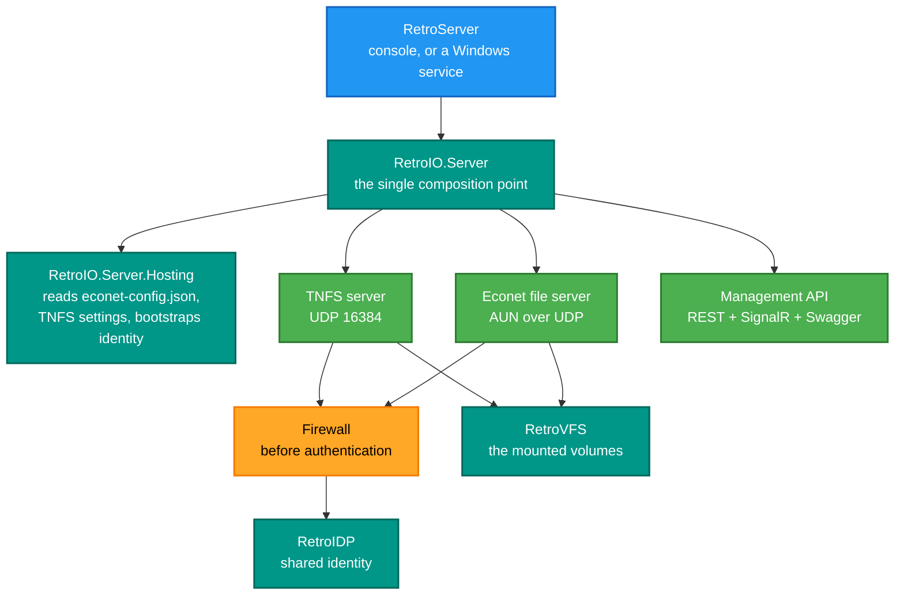
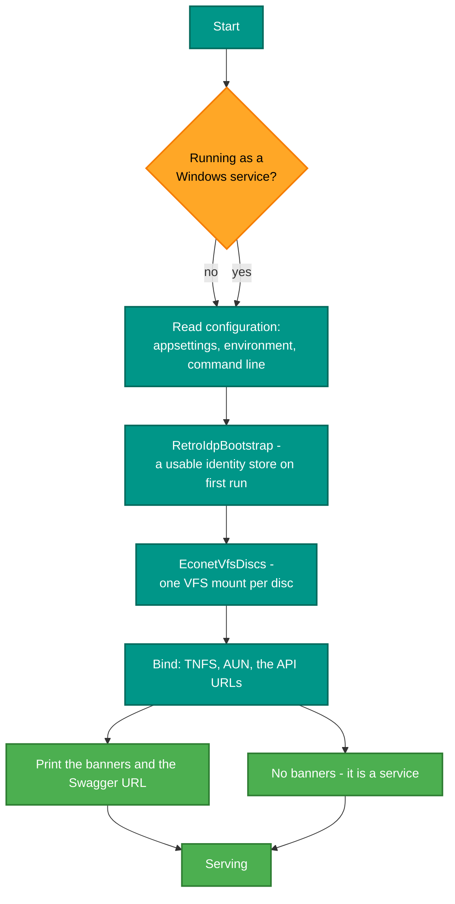

# RetroServer — the file server

<!-- A still screenshot of RetroServer.Service doing its job. PNG, under 10 MB. Uncomment when
     the capture exists; keep the alt text, it is all a screen reader gets.

-->

## What it is

The server. It hosts a **TNFS** server, an **Econet/AUN** file server and a **DriveWire** server over shared storage,
an **XMSG hub** and **XMSG node** for Norsk Data machines, and a **dial-up** internet service; it exposes a REST and
SignalR **management API**, and runs as a console application, as a **Windows service**, or in a **Docker** container
([docs/DOCKER.md](../docs/DOCKER.md)).

**Every protocol starts off.** Switch one on in its settings file (`"Enabled": true`) or for one run on the
command line (`--Tnfs:Enabled=true`). An install from before 2026-11-23 keeps the switches it had.

## Why you need it

It is the thing that actually answers a retro machine. Everything else in this family either implements a protocol
(RetroIO) or administers a running server (RetroAdmin); this is the process that listens.

Running as a Windows service matters more than it sounds: a file server that only exists while somebody has a
console window open is not a file server. It installs, starts with the machine, and logs somewhere you can read
afterwards.

The management API is part of the server rather than a separate process for a simple reason — it needs the live
objects. Statistics, sessions and settings are read from the running protocol servers, not from a file they wrote.
`TnfsServerStatistics` used to be hardcoded zeroes in the API; it is now the same singleton the protocol server
increments, which is the only way the number reported is the number that happened.

## What you can use it for

- **Serving files to real hardware** over TNFS and Econet at once, from the same storage.
- Running it as a **Windows service**, installed and automatic.
- Administering it live from `RetroAdmin`, or from anything that speaks HTTP.
- Trying the API by hand through **Swagger**, whose URL is printed at start-up.
- Serving a mix of sources: a directory, a disk image, a remote share — see `econet-config.json`'s `Discs[]`.
- Reading the startup banner to confirm what actually came up, and on which URLs.

## Prerequisites

| # | Requirement | Why | How to check |
|---|---|---|---|
| P1 | .NET SDK as pinned in `global.json`, or the published exe | To build or run | `dotnet --info` |
| P2 | RetroIO packed to the local feed | Restore | `dir ..\localfeed` |
| P3 | **UDP 16384 free** | TNFS | `netstat -ano \| findstr 16384` |
| P4 | A free UDP port for AUN | Econet | |
| P5 | Free HTTP port(s) for the API | `RetroAdmin`, Swagger | The defaults are printed at start-up |
| P6 | Something to serve | Anything useful | A directory, or `econet-config.json` `Discs[]` |
| P7 | Administrator rights | **Installing the Windows service only** | Running in the console needs none |
| P8 | `RETROFS_DATA_PATH` understood | It moves the data directory **and the image corpus** | `$env:RETROFS_DATA_PATH` |

```powershell
src\publish\win-x64\RetroServer.exe                                          # console
RetroServer.exe --Management:Urls=http://localhost:5100;https://localhost:5101
```

### Configuration

Standard .NET configuration, so every setting can come from `appsettings.json`, the environment, or the command
line. Two groups worth knowing:

| Key | What it does |
|---|---|
| `Management:Urls` | Where the management API listens. Semicolon-separated. Defaults are printed at start-up |
| `Management:Swagger` | `true` serves the Swagger page at `/swagger` (default `true`) |
| `Management:LogLines` | Log lines kept for RetroAdmin (default 1000) |
| `Telemetry:OtlpEndpoint` | Send statistics and logs to an OpenTelemetry collector (default off); see [docs/TELEMETRY.md](../docs/TELEMETRY.md) |
| `Tnfs:` … `Econet:` … `DriveWire:` … `XmsgHub:` … `XmsgNode:` … `DialUp:` … | Each protocol's settings, `Enabled` first |

`RetroServer --help` lists every key the server reads. A key that is not read fails silently, so check
there rather than guessing.

### Running as a Windows service

The executable installs and manages itself; `WindowsServiceInstaller` handles the commands. When it runs as a
service it **does not print the banners** (`WindowsServiceHelpers.IsWindowsService()`), so an empty console is not
a failure.

## What it hosts



**The firewall runs before authentication**, so a refused host never presents credentials.

## Starting up



First run creates a usable identity store by itself — a server whose very first start needed a manual
user-creation step is a server nobody gets working.

## Related

- `RetroIO.Server.Hosting` (`RetroIO/src/RetroIO.Server.Hosting/README.md`) — the configuration loading
  and disc composition this host uses.
- `RetroIO.Management.Api` (`RetroIO/src/RetroIO.Management.Api/README.md`) — the API it exposes.
- [`RetroAdmin`](../RetroAdmin.Desktop/README.md) — the desktop administration app.
- `tnfs-stress` (`RetroIO/src/tools/RetroIO.Tools.TnfsStress/README.md`) — load-test the TNFS side. Note it
  targets `localhost:16384` **hard-coded**.
