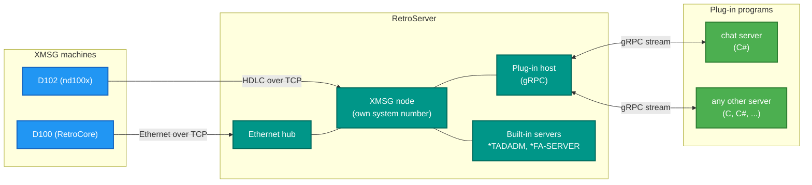
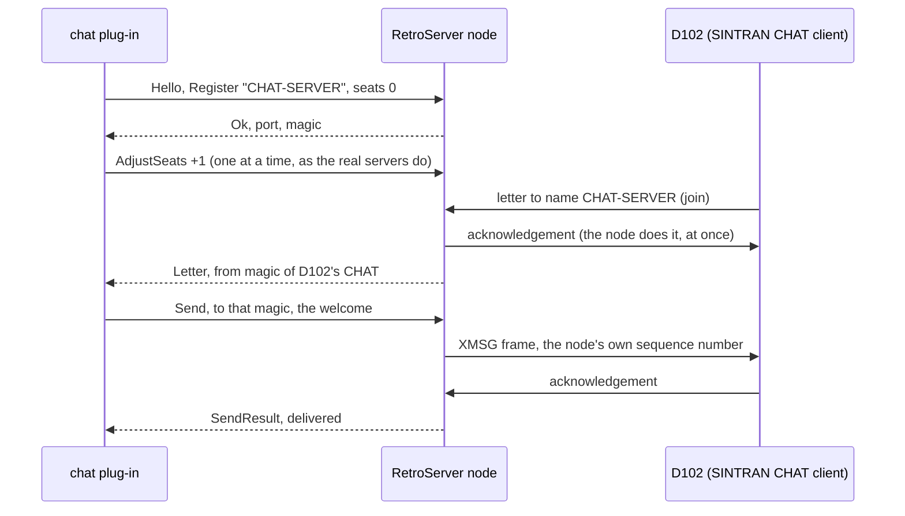

# XMSG plug-in servers

**Status (2026-11-10): RetroServer hosts its own XMSG node, and programs connect to it** (switch it on in
`xmsgnode-config.json`). The developer documents are in RetroIO, `docfx/xmsg/`: building programs, the protocol
reference, logging, and versioning. Decided by Ronny on 2026-11-10: plug-in servers talk to RetroServer over
gRPC, and the first one is chat. Where something below is not verified, it says so.

## What is built (RetroIO, uncommitted)

| Package | What it does |
|---|---|
| `RetroIO.Protocols.Xmsg.Plugins.Contracts` | `xmsg_plugin.proto`, the contract, and the C# code generated from it |
| `RetroIO.Protocols.Xmsg.Plugins` | The node's side: `PluginServerHost` does each request on the node's pump thread; `PluginConnectionService` is the gRPC service |
| `RetroIO.Protocols.Xmsg.Plugins.Client` | A C# plug-in's side: `PluginConnection` gives the XMSG kernel and XROUT name calls, carried over the stream |

Proved by unit tests, over a real gRPC stream in memory:
- the C# chat server runs as a plug-in, claims `*CHAT`, and answers a join that reached the node off the wire with
  a welcome, which leaves the node as a frame for the sender's system;
- a plug-in that disconnects loses its name;
- a C# chat client and the chat server, both connected to the same node, talk through the node's ports: the client
  joins, is welcomed, and what it says comes back from the room.

**RetroServer's node** (`XmsgNodeService`, built 2026-11-10, off by default). Settings in `xmsgnode-config.json` in
RetroServer's data folder: `Enabled`, `SystemNumber`, `PeerSystemNumber`, `Ethernet` (default
`tcp:127.0.0.1:5010`, RetroServer's own hub), `ProgramBindAddress` and `ProgramPort` (default 127.0.0.1:5011),
`ProgramToken`, `Motd`. The node joins the hub, runs the TAD terminal server, and opens the port programs connect
to. Proved by a unit test that starts a real hub and the node on real ports, and connects the chat server and a
chat client to it. Limits, in RetroIO `src/BUGS.md`: one peer machine only, and two port allocators on one node.

**One token, and each program says what it needs** (Ronny, 2026-11-10). RetroServer keeps no settings for any
program. A program tells RetroServer what it needs when it connects (the name to claim, the seats, the ports). The
only thing the two must agree on is a secret: `ProgramToken` in RetroServer's config, and `Token` in the program's
own config file. Empty means insecure mode, where anything that reaches the port may connect. When a token is
set it is ALWAYS checked, also for a program on the same machine. A wrong or missing token is refused with XEPVR.

**Each program has its own config file** (Ronny, 2026-11-10): `retro-chat-server.json` and `retro-chat.json`
next to the program, written with the defaults when missing. Command-line flags only override them for one run.

**C# client programs connect to RetroServer** (Ronny, 2026-11-10). RetroServer is the XMSG machine. A C# client
opens its port on RetroServer's node over the same connection a plug-in uses, and is never an XMSG machine of its
own. Emulators are the opposite: they are always XMSG machines and never connect this way. The programs, in
RetroXmsg: `retro-chat-server` (the chat server) and `retro-chat` (a terminal chat client).

Fixed on the way, because chat could not have worked without them. All three are in RetroIO `src/BUGS.md`,
under Fixed:
- **The node now finds the server for a letter by the letter's name parameter.** It used to scan the frame for
  the first text starting with `*`.
- **A task now gets the whole letter, header first, as XROUT gives it on a SINTRAN machine.** Before, it got the
  data alone. The SINTRAN chat server reads its data at `4 + the length word`
  (`CHATSV.PLNC`, measured on D100 2026-08-18).
- **A letter from a machine now reaches a name that a task-style server claimed in its own name table.**
- **A task's port-to-port message now goes on the wire as a SINTRAN task's does:** frame flags 0x82, role 0x84,
  the length in the length word, the data at offset 28. Measured from D100's own chat Welcome. Before, the bridge
  used a layout of its own (data at offset 32) that no machine was seen to use.

**What the contract turned into.** It is close to the sketch below, with one difference: it works at the level of
single XMSG calls (open a port, send from a port to a magic number, claim a name) rather than at the level of
"register a server". That way the chat server, written as a SINTRAN task, runs unchanged on either side. The
actual file is `RetroIO.Protocols.Xmsg.Plugins.Contracts/src/xmsg_plugin.proto` in RetroIO.

## What a plug-in server is

An XMSG server is a program that a SINTRAN machine reaches by name, for example `*TADADM` (log in),
`*FA-SERVER` (files) or a chat server. Today every such server is C# code compiled into the node.

A **plug-in server** is a small program, in C, C#, or any other language, that **only runs the server code**.
It runs as its own process. It connects to RetroServer, claims a server name, and from then on RetroServer
forwards to it everything the machines send to that name, and sends back what it answers.

**An emulator is never a plug-in client.** nd100x, RetroCore and real machines reach a server only as XMSG
machines, over the Ethernet hub or an HDLC line. They never use the plug-in connection. The plug-in
connection is between RetroServer and the server program only.



## Why not a DLL, why not raw frames

**Not a DLL loaded from the config.** A DLL runs inside RetroServer. A crash or a hang in it stops the node's
single working thread, and with it every link to every machine. It also ties the server to C# and to
RetroServer's build.

**Not raw XMSG frames over the wire to the plug-in.** If a plug-in got raw frames, every plug-in would have to
get the hard rules right on its own:
- choosing sequence numbers;
- acknowledgements;
- spotting a resent request and sending the same answer again;
- answering a closed port with an error.

Those rules would then exist once per plug-in, each copy a little different. That is the mistake this
project has paid for before.

**So the boundary sits where SINTRAN puts it for its own tasks.** A SINTRAN program never sees frames. It
opens a port, claims a name, receives a letter, reads it, sends an answer and closes the port. The plug-in gets
exactly that, and RetroServer keeps every wire rule in one place.

## Who does what

| RetroServer (the node) | The plug-in |
|---|---|
| Links, the hub, HDLC lines | Nothing about links |
| Acknowledgements, sequence numbers per machine, saved state | Nothing about sequence numbers |
| Recovery when a machine's sequence is out of step | |
| Resending our own messages, spotting resent requests | |
| The error for a closed port | |
| The name table: the plug-in's name shows in LIST-NAMES and `list servers` | Chooses its name and seat count |
| Port numbers and magic numbers (the address SINTRAN uses for a port) | Uses the numbers it is given |
| | Reads what arrived, decides the answer, sends it |

## The connection

**Who dials whom.** The plug-in dials RetroServer. RetroServer listens on its own gRPC port, local only by
default. A plug-in on another machine needs TLS and a login, the same rules as the hub (see
`PLAN-XMSG-X25.md`, "Hub over the internet").

**One gRPC stream per plug-in, both ways.** The plug-in sends requests; RetroServer sends events. Every
request carries an id, and its answer carries the same id.

A sketch of the contract (names and fields are a proposal, not final):

```protobuf
syntax = "proto3";
package retroserver.xmsg.plugin.v1;

service XmsgPluginHost {
  // One stream for the life of the plug-in. Closing it releases everything the plug-in held.
  rpc Connect(stream PluginRequest) returns (stream HostEvent);
}

message PluginRequest {
  uint32 id = 1;                          // echoed in the answer
  oneof body {
    Hello        hello         = 2;      // first message: plug-in name, version, login when remote
    Register     register      = 3;      // claim a server name
    Unregister   unregister    = 4;
    OpenPort     open_port     = 5;      // an extra port, for example one per conversation
    ClosePort    close_port    = 6;
    Send         send          = 7;      // send bytes from one of our ports to a magic number
    AdjustSeats  adjust_seats  = 8;      // free connections shown in LIST-NAMES
    Ping         ping          = 9;
  }
}

message Register   { string name = 1; uint32 seats = 2; bool connection_port = 3; }
message OpenPort   { }
message ClosePort  { uint32 port = 1; }
message Send       { uint32 from_port = 1; uint32 to_magic = 2; bytes data = 3; bool secure = 4; }
message AdjustSeats{ sint32 delta = 1; }

message HostEvent {
  uint32 answers_id = 1;                  // 0 for an event nobody asked for
  oneof body {
    Ok           ok            = 2;       // with the port and magic number when one was made
    Refused      refused       = 3;       // the XMSG error code, for example name already taken
    Letter       letter        = 4;       // a letter to our NAME arrived
    Data         data          = 5;       // data to one of our ports arrived
    PortClosed   port_closed   = 6;       // the other side closed, or the machine went away
    LinkDown     link_down     = 7;       // a machine is no longer reachable
    SendResult   send_result   = 8;       // delivered (acknowledged) or failed, with the error
  }
}

message Ok        { uint32 port = 1; uint32 magic = 2; }
message Refused   { uint32 xmsg_error = 1; string text = 2; }
message Letter    { uint32 port = 1; uint32 from_magic = 2; uint32 from_system = 3; bytes data = 4; }
message Data      { uint32 port = 1; uint32 from_magic = 2; uint32 from_system = 3; bytes data = 4; }
message PortClosed{ uint32 port = 1; }
message LinkDown  { uint32 system = 1; }
message SendResult{ uint32 xmsg_error = 1; }
```

## Life of a plug-in



**Threads.** The node keeps all its state on one thread, with no locks. gRPC runs on its own threads, so
those threads only put requests in a queue, and the node's pump thread takes them out. This is the same rule
the Ethernet links already follow (`DeliverInboundOnPump`). Events to the plug-in are queued per stream, so a
slow plug-in only delays itself.

**In the node, each connected plug-in is one server.** It appears in the server list like `*TADADM`, so
LIST-NAMES and `list servers` show it without any special code.

**When the stream drops or the plug-in stops answering.** RetroServer releases its name and its ports.
New letters to that name then get the same error a SINTRAN machine gives for a name that is not there.
When the plug-in comes back it registers again; conversations from before are gone, the same as when a
SINTRAN server program is restarted. A missed ping (the interval is a setting) counts as a drop.

**A slow answer.** The node acknowledges a frame before the plug-in sees it, so a slow plug-in does not make a
machine resend. How long a SINTRAN client waits for the answer itself is **not known yet**; it decides the
default time limit.

## Chat as the first plug-in

**What exists.**
- RetroIO's `RetroIO.Protocols.Xmsg.Chat` has a C# chat server: rooms, users, and trunks between servers.
- It uses the same message bytes as the SINTRAN chat product (the PLANC programs `CHATSER` and `CHAT`).
  Golden-byte tests pin those bytes on both sides.
- It is written as a SINTRAN task would be. It uses only task calls: open a port, claim a name, add seats,
  receive, read, send, close.
- Nothing outside the tests starts it today.

**How it becomes a plug-in.**
1. A small library for C# plug-ins gives the same task calls the chat server uses today, carried over the
   gRPC stream. Today the chat server takes the in-process kernel class (`XmsgKernel`) and the in-process
   name table (`XroutDirectory`) directly, so it needs an interface in their place. That is the one change in
   the chat package. Its rooms and messages stay as they are.
2. A small program `retro-chat-server` starts the chat server on that library and connects to RetroServer.
3. RetroServer's config names nothing about chat. The plug-in brings its own name.

**Not verified.** Nobody has yet joined the C# chat server from the SINTRAN `CHAT` client on a real machine.
The bytes match by test, but a live run is the proof.

## What RetroServer needs first

The plug-in host needs an XMSG node inside RetroServer, with its own system number, and the node needs these
fixes. Each one is written up in RetroIO `src/BUGS.md`, dated 2026-11-10:
- An error for a closed port. Without it a SINTRAN sender hangs.
- Resending our own messages when they are not acknowledged.
- Finding a letter's server name from the letter itself, not by scanning for `*`.
- One name table, shared by the node and the task-style servers.
- Spotting resent requests in the node, once, instead of in each server.
- Still open, needing a capture of a real machine: does a reply have to reuse the request's sequence number?

## Order of the work

1. ~~The node in RetroServer~~ DONE 2026-11-10 for ONE peer machine (see above). Many peers is Phase 2 of
   `PLAN-XMSG-X25.md`. Not yet run against a live machine.
2. **The node fixes still open** in RetroIO `src/BUGS.md`: no XROUT error for an unknown name, no error for a
   closed port, no resends of our own messages, plug-in names missing from LIST-NAMES.
3. ~~The plug-in host~~ DONE 2026-11-10 (RetroIO, see above).
4. ~~The C# plug-in library, `retro-chat-server` and the `retro-chat` client~~ DONE 2026-11-10 (built and unit
   tested; not run live, because step 1 is not done).
5. **Live proof, the way Ronny chose (2026-11-10):** CHATSER keeps running on D102, and D102 users keep joining it
   there, because the SINTRAN CHAT client only joins on its own machine. CHATSER on D102 then connects to the C#
   chat on RetroServer over its server-to-server link (CHAT-TRUNK). This first needs the C# server's side of
   that link checked against `CHATSV.PLNC`.
6. **Admin UI:** a page listing the connected plug-ins, their names, seats, ports and counters.
7. **A C plug-in example**, to prove the contract works without C#.

## Open questions

- How long a SINTRAN client waits for an answer. This sets the plug-in time limit.
- Whether a reply must reuse the request's sequence number (in BUGS.md).
- ~~The server name the SINTRAN `CHAT` client looks up.~~ SETTLED 2026-11-10 by reading the source: `*CHAT`
  (NDInsight `SINTRAN/XMSG/SINTRAN-CHAT/CHAT.PLNC`, `servName`). The room travels inside the join message.
- **The SINTRAN `CHAT` client cannot join a server on another machine as it is.** Its join letter always goes to
  its own system: `hereSystem` is empty in `CHAT.PLNC` (line 722) and nothing sets it (checked 2026-11-10). Its own
  wire registry lists "how does a system-qualified name travel" as unknown (C2 in `protocols/chat-wire.md`). Two
  ways for D102 users to reach the chat on RetroServer:
  - give the client a way to name the system, a change to the PLANC program;
  - let the SINTRAN chat server on D102 (`CHATSER`) join the RetroServer chat over a trunk (`CHAT-TRUNK`), as
    two chat servers do in the federation design. The C# chat server already has trunks.

  This is Ronny's choice.
- The layout of plain port-to-port data between two machines (the welcome, and everything after the join). The
  bridge uses its own layout, never checked against a capture of SINTRAN tasks talking across machines (RetroIO
  `src/BUGS.md`).
- Where the gRPC port lives in the config, and whether plug-ins need a right of their own in the user model.
